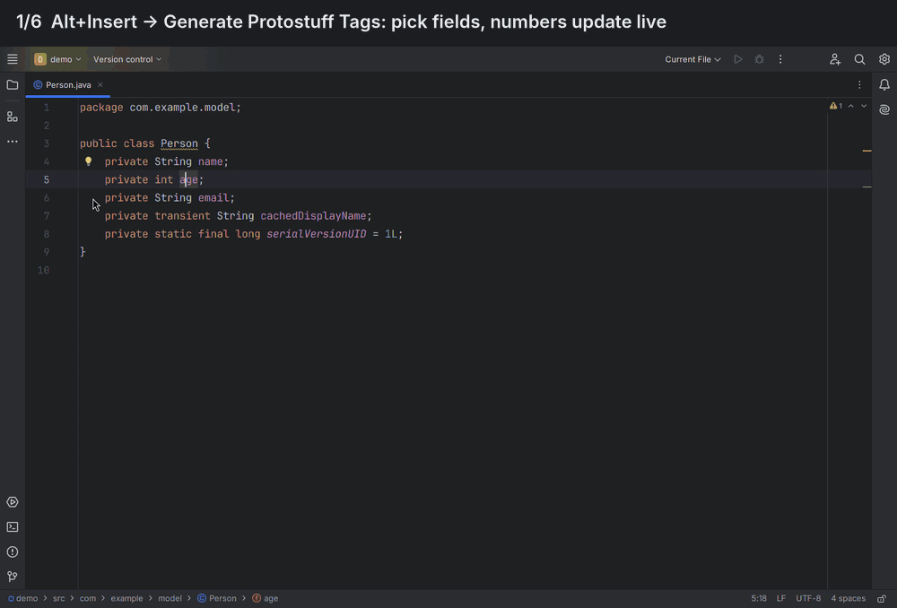
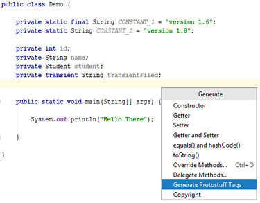
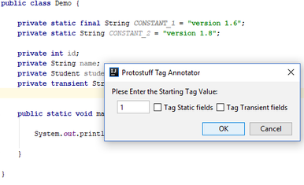
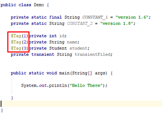

#  Protostuff `@Tag` annotator
IntelliJ IDEA plugin that adds and checks [Protostuff](https://protostuff.github.io/docs/protostuff-runtime/) `@Tag` annotations in Java and Kotlin classes.



## Features

### Generate tags for a class
Put the caret inside a class, then **Code → Generate** (Alt+Insert, Cmd+N on macOS) → **Generate Protostuff Tags…**.
The dialog lists the untagged fields with the number each will get. Untick fields to leave them out, change the starting number, or include transient fields. The numbers update as you go.

When the class already has tags, the starting number defaults to one more than the highest, so existing numbers stay put.

### Tag a single field
Alt+Enter on a field → **Add @Tag(n)**. It uses one more than the highest number in the class and its superclasses. Gaps aren't filled, because a gap is often a removed field whose number shouldn't be reused.

### Inspection
**Protostuff @Tag problems** (Settings → Editor → Inspections → Protostuff) warns about:
- a field without `@Tag` in a class where other fields have one, including inherited fields. Once any field is tagged, Protostuff requires every serialized field to be tagged;
- two fields with the same number, including numbers used in a superclass;
- numbers below 1 or above 536870911 (2²⁹−1);
- `@Tag` on a static, transient or `@Exclude` field, which Protostuff ignores;
- in Kotlin, `@Tag` on a constructor `val`/`var` without `field:`, which ends up on the constructor parameter instead of the field.

Quick fixes: **Tag the remaining fields** (also in superclasses), **Use the next free tag number**, **Remove @Tag**, **Change to @field:Tag**.

### Many classes at once
Right-click files, packages or folders in the Project view → **Protostuff** → **Generate**, **Renumber** or **Remove**. Generate can continue after the highest tag in each class or start from a fixed number, and can be limited to classes that already use `@Tag`.

### Renumber and remove
**Code → Protostuff → Renumber Protostuff Tags…** renumbers the tagged fields in declaration order. Data serialized with the old numbers can't be read correctly afterwards, and the dialog says so.
**Remove Protostuff Tags…** removes every `@Tag`, along with the import if it's no longer used.

### Rules used everywhere
- Writes `@Tag(n)` and adds `import io.protostuff.Tag` if it isn't already imported. The fully qualified `@io.protostuff.Tag` is used only when `Tag` already means a different class in that file.
- Numbers used anywhere in the class hierarchy are never reused. Untagged superclass fields reserve one number each, top-most class first.
- Static and `@Exclude` fields are never tagged. Transient fields are skipped unless you choose them.
- The dialogs remember the transient, "only tagged classes" and renumber-start choices.

### Kotlin
Works on constructor `val`/`var` parameters and body properties that have a backing field. Tags are written as `@field:Tag(n)`: `io.protostuff.Tag` declares no `@Target`, so without `field:` Kotlin would put it on the constructor parameter, where Protostuff doesn't look. It skips computed properties, delegated properties (`by lazy`), `const`, and `object`/companion members. `@Transient` (`kotlin.jvm.Transient`) is treated as transient. Supports both the K1 and K2 Kotlin modes.


--

--


## Changes
See [CHANGELOG.md](CHANGELOG.md) for what changed in each version.

## Building
Requires JDK 21 to build. Supports IntelliJ IDEA 2022.2 and later.

```bash
./gradlew buildPlugin   # plugin zip in build/distributions/
./gradlew test          # run the tests
./gradlew runIde        # start a sandbox IDE with the plugin installed
./gradlew verifyPlugin  # check API compatibility with IDEA 2022.2, 2024.2 and 2026.3
```

The code is split into a language-neutral model (`model/`) with Java (`java/`) and Kotlin (`kotlin/`) implementations. The Kotlin part is loaded only when the Kotlin plugin is installed.

## License
Copyright 2018-2026 Dushmantha Bandaranayake.

Licensed under the [Apache License, Version 2.0](LICENSE). You may use, modify and distribute this plugin, including commercially, as long as you keep the copyright and license notices and state any changes you make. It comes with no warranty. See [NOTICE](NOTICE) for attribution.
